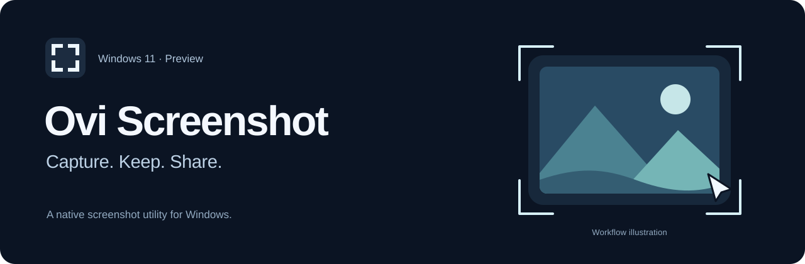
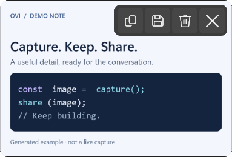
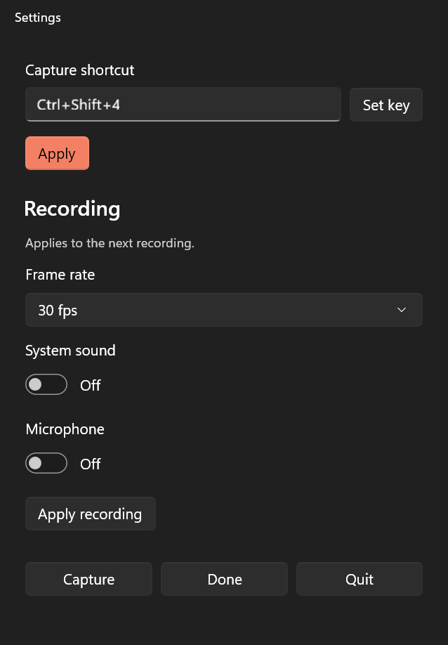

# Ovi Screenshot

[](https://github.com/ovidijusr/ovi-screenshot/actions/workflows/windows.yml)

**Native screenshots and screen recording for Windows 11.** Capture an area or a window, keep it in a floating preview, and copy, save, open, or drag the PNG into another app. Record an area or window to MP4 with Pause, Resume, and Stop.

**Development preview · Windows x64 · Build from source.** No prebuilt release yet. Preview packages are unsigned, and license selection is pending.

[Build and run](#build-and-run) · [How it works](#how-capture-works) · [Architecture](docs/architecture.md) · [Limitations](#current-limitations)

## What it does

- **Select an area or a window.** Drag a region across one or more monitors, or press Space to pick a window. The selection stays undimmed; window captures preserve available transparency and get a soft generated shadow.
- **Keep each capture within reach.** Previews stack at the screen edge. Hover for Copy, Save, Delete, and Close; double-click to open the full image, or drag its PNG into another app. Delete removes the app's capture immediately; saved/shared copies stay.
- **Record an area or a window.** A cancellable three-second countdown, a visible boundary, and compact recording controls. Settings offers 15, 24, 30, or 60 fps and separate system sound and microphone switches. Audio starts off; paused time is excluded from the MP4.
- **Use native Windows controls.** Start from the tray or your chosen shortcut. Menus and settings follow the Windows theme, and preview actions support keyboard focus.

A short, soft sound confirms successful screenshots. Canceling a capture stays silent.

## App gallery

<table>
  <tr><th>Floating screenshot preview</th><th>Settings</th></tr>
  <tr>
    <td></td>
    <td></td>
  </tr>
</table>

**Recording controls and countdown**

<p>
  
  
</p>

The gallery shows real app views rendered by the native WinUI fixture using generated demo content. The banner's capture scene is a labeled illustration.

## Why this structure

The goal is a short capture-to-use workflow with native desktop behavior. CleanShot X inspired the capture-and-preview interaction; this is an independent implementation.

The Windows app uses C# with WinUI 3 for controls and thin Win32 adapters for tray integration, shortcuts, window management, and selection. Windows capture and media APIs handle acquiring pixels and encoding video. Keeping these responsibilities in the platform app gives the UI direct access to Windows focus, clipboard, drag-and-drop, and file dialogs.

Rust owns the portable still-image processing: validated image buffers, preview rendering, window-shadow composition, and PNG encoding. The C# app calls it through a versioned C ABI and `SafeHandle` wrappers. This boundary is intended to let a future macOS app reuse the image processing while providing its own native capture and UI. The macOS app is not implemented.

## How capture works

For an area screenshot, the app hides its previews, captures the connected displays into a frozen virtual-desktop image with GDI `BitBlt`, and displays a Win32 selection overlay. Selections can cross monitor boundaries, including displays above or left of the primary monitor. Captured physical pixels are kept at their original size; gaps in an uneven monitor layout appear black. The selected pixels pass through the Rust image core to produce the preview and full-resolution PNG.

Window selection resolves an HWND and captures it with `Windows.Graphics.Capture`. It does not use the window's rectangle as a crop of the desktop. Available transparency is preserved; the surrounding soft shadow is generated by the app, not copied from DWM.

Recording uses `Windows.Graphics.Capture` for the chosen monitor area or native window and feeds BGRA frames to the Windows media encoder for H.264 MP4 output. Optional WASAPI system sound and microphone capture use NAudio, mix to PCM, and encode as AAC in the same file. One active recording clock supplies elapsed time and media timing so pauses are excluded. Recording stays in the Windows app; it does not pass through Rust.

Settings and caches live under `%LOCALAPPDATA%\OviScreenshot`. Preview PNGs can spill to disk above a 64 MiB resident PNG budget; thumbnails and active read buffers are outside that budget. Export files remain available for receiving apps, with seven-day inactive cache retention. This cache is not a browsable screenshot history. See [architecture](docs/architecture.md) for ownership and lifecycle details.

## Build and run

Prerequisites:

- Windows 11 x64.
- The .NET SDK selected by [global.json](global.json).
- MSVC C++ build tools and a Windows SDK. Visual Studio 2022 Build Tools with the Desktop development with C++ workload supplies these; an IDE is not required.
- Network access for the initial toolchain and dependency downloads.

From the repository root in PowerShell:

```powershell
.\scripts\bootstrap.ps1
.\scripts\build.ps1
.\scripts\run.ps1
```

Bootstrap installs the pinned Rust toolchain under `.tools` without changing global PATH or user profiles. Build compiles the Rust DLL and Windows app and runs the Rust, image-bridge, and synthetic recording checks. [Development instructions](docs/development.md) cover prerequisites, output paths, and the separate native UI fixture.

The app starts in the notification area near the clock. Click the capture-frame icon to select a screenshot area; right-click for recording, Settings, or Quit. The default capture shortcut is **Ctrl+Shift+4**. Existing profiles retain their configured shortcut; change it in Settings → Set key.

During selection, **Space** switches between area and window mode and **Escape** cancels. Hover over a preview for its actions, or focus it and use **Ctrl+C**, **Ctrl+S**, **Delete**, and **Escape**. Delete removes the capture; Escape only dismisses its preview. Double-click the image, or press Enter on its focused image, to open it.

After building, [Start Ovi Screenshot.cmd](Start%20Ovi%20Screenshot.cmd) launches the latest successful development build. Quit an older running instance before switching versions. The [release guide](docs/release.md) explains how to produce a self-contained portable ZIP; packaging does not publish it.

## Current limitations

- Windows 11 x64 only. No macOS app or Windows ARM64 build is provided.
- Configured FPS is a target; capture and encoding performance depend on the source and hardware. Window recording follows movement and finishes when its source closes, minimizes, or changes size. Audio device removal ends the recording rather than silently losing a requested source.
- Capture is SDR. HDR conversion and wide-gamut color fidelity are not implemented.
- Screenshots can span displays. Area video stays on one monitor; start its selection on the monitor you want to use. Window video records one native window.
- No annotation editor, redaction tools, background editor, OCR, scrolling capture, cloud sharing, or browsable editable history.
- Window capture depends on the source and Windows capture support. Protected or unavailable content cannot be assumed capturable.
- No signed release, installer, or automatic updater. A distribution license and dependency notice audit are still required before a binary release.

Automated checks use generated images, video frames, and the app's own fixture windows. They check the Rust/native boundary, geometry, output pixels, and video timing/orientation. They do not establish physical keyboard mappings, clean-machine deployment, or clipboard/drag behavior in every receiving app. Those remain session and hardware checks documented in [development](docs/development.md) and [release validation](docs/release.md).

## Source layout

```text
apps/windows/       C#/WinUI app, Win32 adapters, capture and recording
  Services/         Capture/recording coordination, settings and cache ownership
  Views/            Native UI surfaces and preview interactions
  Interop/          Managed wrappers for the Rust C ABI
  Testing/          Generated-content native UI fixtures
crates/core/        Portable image processing and PNG output
crates/core-ffi/    C ABI and Rust allocation ownership
bindings/include/  Shared C header and future Swift module map
scripts/           Local toolchain, build, run and packaging scripts
docs/              Architecture, development, product plan and release notes
```

[Contributing](CONTRIBUTING.md) · [Changes](CHANGELOG.md) · [Security](SECURITY.md)

Ovi Screenshot is not affiliated with CleanShot X.
